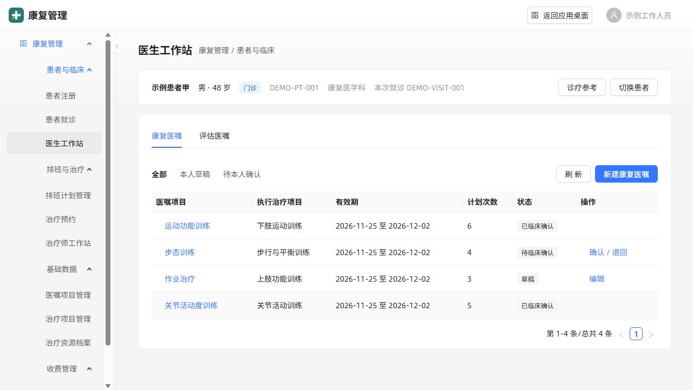
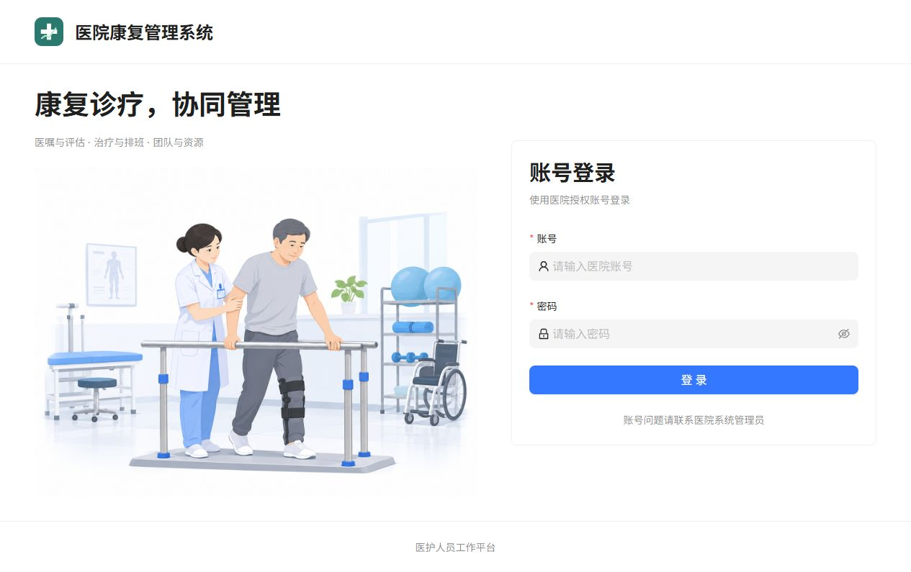
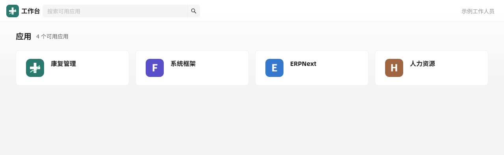
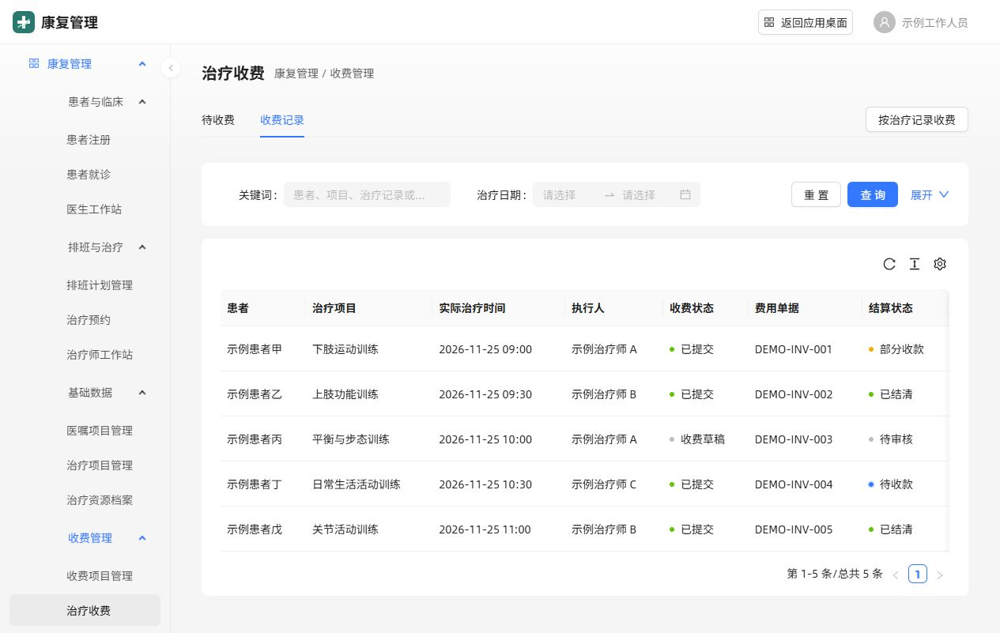

# 康复工作台 · Rehab Console

**为医院康复科和康复机构打造的开源业务前端，覆盖从患者就诊到治疗收费的日常工作。**

[](https://github.com/jerry317395616/rehab-console/releases)
[](https://github.com/jerry317395616/rehab-console/actions/workflows/ci.yml)
[](LICENSE)

[界面展示](#界面展示) · [快速开始](#快速开始) · [后端接入](docs/integration.md) · [参与贡献](#参与贡献) · [English](README.en.md)

## 项目概览

医生可以从就诊记录开立康复和评估医嘱。排班人员按治疗师日程安排预约，治疗师在工作台登记到诊、执行并提交治疗记录，收费人员据此处理应收、收款和退费。各岗位使用同一个前端，能看到的菜单和数据由后端权限决定。

| 工作场景 | 已支持的流程 |
| --- | --- |
| 患者与临床 | 患者注册、就诊登记、医生工作站、康复医嘱、评估医嘱 |
| 排班与执行 | 治疗组、人员排班、治疗分派、治疗预约、治疗师工作站 |
| 治疗收费 | 按已完成的治疗记录生成收费草稿、提交销售发票、分次收款、贷项核销与退款 |
| 基础资料 | 医嘱项目、治疗项目、治疗资源、设备、病历模板、量表题库 |

前端基于 React、TypeScript、Umi 和 Ant Design Pro，复用 Frappe 的登录会话。菜单、记录访问、单据提交和业务校验均由后端授权。

## 界面展示

以下是康复工作台使用模拟数据运行时的截图。

### 医生工作站

在患者当前就诊中查看康复医嘱与评估医嘱，并跟踪草稿和临床确认状态。



<details>
<summary>查看登录页、应用桌面和治疗收费</summary>

**登录页**



**应用桌面**



**治疗收费**



</details>

## 快速开始

**安装 Node.js 22 或更新版本和 npm。** 登录并运行完整业务流程需要一个装有兼容 Rehab 应用的 Frappe 测试站点。本仓库提供前端源码和使用模拟会话的自动化测试。

```bash
git clone https://github.com/jerry317395616/rehab-console.git
cd rehab-console
npm ci
```

开发代理默认将请求转发到 `http://127.0.0.1:8001`。若测试站点使用该地址，直接运行 `npm run dev`。若使用其他地址，通过 `REHAB_API_TARGET` 指定，例如：

```bash
REHAB_API_TARGET=http://127.0.0.1:8080 npm run dev
```

<details>
<summary>Windows PowerShell</summary>

```powershell
$env:REHAB_API_TARGET = 'http://127.0.0.1:8080'
npm run dev
```

</details>

启动后打开[本地工作台](http://localhost:8000/console/user/login)，使用测试站点上的系统账号登录。接口约定、生产部署路径和静态资源打包方法见[后端接入指南](docs/integration.md)。

## 本地验证

使用合成数据和模拟 Frappe 会话运行下列检查。无需测试站点账号。

```bash
npx playwright install chromium
npm run lint
npx antd lint ./src
npm test
npm run e2e
npm run build
```

`npm test` 运行组件和服务测试，`npm run e2e` 校验从登录页进入应用桌面的流程，生产构建输出到 `dist/`。

## 参与贡献

- **报告问题**。提供受影响的工作流程、预期表现和可复现步骤，使用合成数据替代患者信息。 [提交 Issue](https://github.com/jerry317395616/rehab-console/issues/new)
- **讨论用法或提出改进建议**。欢迎分享不同康复机构的流程需求。 [讨论区](https://github.com/jerry317395616/rehab-console/discussions)
- **提交代码或文档**。请在 PR 中说明改动涉及的业务流程和验证方法。 [贡献指南](CONTRIBUTING.md)
- **私密报告安全问题**。使用仓库的安全报告入口。 [安全政策](SECURITY.md)

当前优先事项是提供无需后端账号的公开演示、整理后端兼容版本，并补齐预约和收费的端到端测试。

## 项目联系

- 微信 `so342910289`
- 电话 `15829770606`

## 许可证

项目采用 [MIT 许可证](LICENSE)。工作台基于 [Ant Design Pro](https://github.com/ant-design/ant-design-pro)，通过 [Frappe Framework](https://github.com/frappe/frappe) 接入后端业务能力。
